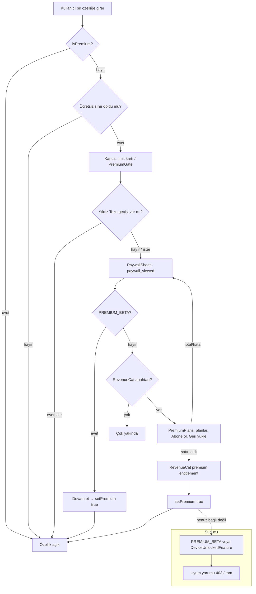

# Premium akışı: kontrol noktaları ve kancalar

Son güncelleme: 2026-11-19. Durum: herkes Premium (`PREMIUM_BETA=true`). RevenueCat kodu hazır, anahtarlar girilince açılıyor.

## 1. Premium kim, nerede karar veriliyor

| Katman | Kaynak | Not |
| --- | --- | --- |
| Mobil bayrak | `EXPO_PUBLIC_PREMIUM_BETA` (`apps/mobile/src/services/config.ts`), eas.json'da üç profilde `"true"` | Tanımsızsa **true** sayılır |
| Mobil durum | `useAppStore.isPremium` (persist). Rehydrate'te `PREMIUM_BETA` değerine eşitlenir | 2026-11-19 düzeltmesi: beta kapanınca eski `true` artık kalmıyor |
| Mobil abonelik | `services/purchases.ts`: RevenueCat `premium` entitlement'ı → `setPremium(beta \|\| active)` | Anahtar yoksa kapalı |
| Sunucu bayrak | `PREMIUM_BETA` (`app-config.module.ts`, varsayılan **false**) → `DeviceEntitlementService` | Mobil ve sunucu varsayılanları **farklı** |
| Sunucu kilit | `DeviceUnlockedFeature` tablosu, `POST /unlock` (yalnız dev stub) | RevenueCat'i henüz bilmiyor |

## 2. Kapı noktaları (gate)

| Özellik | Ücretsiz sınır | Nerede kontrol | Sunucu doğruluyor mu |
| --- | --- | --- | --- |
| Aster sohbeti | günde 5 mesaj (+ Yıldız Tozu geçişi) | `CompanionScreen.tsx` | Hayır (yalnız AI günlük bütçesi 300) |
| Tarot | günde 1 okuma (+ geçiş) | `TarotScreen.tsx`, `CategoryStep.tsx` | Hayır |
| Haftalık/aylık tahmin | kilitli | `ForecastScreen.tsx` + `PremiumGate` | Hayır |
| En iyi günler (seçim) | arama modu kilitli | `ElectionFormScreen.tsx`, `ElectionCard.tsx` | Hayır |
| Manifest | 1 aktif | `ManifestScreen.tsx`, `CreateWishFlow.tsx` | Hayır |
| Kayıtlı kişi haritası | 2 kişi | `savedPerson.ts`, `PersonScreenFrame.tsx` | Hayır (sunucu üst sınırı 50) |
| Uyum yorumu | 2 açı + kilit | `CompatibilityResultScreen.tsx` | **Evet** (`astrology.controller.ts` 403) |
| PDF rapor | günde 3 | `ReportsScreen.tsx` | Evet (`REPORTS_DAILY_PER_DEVICE`) ama premium bilmiyor |

Kazanılan derinlik (Premium değil, Işık ile açılır): harita bölümleri, tarot açılımları (`TAROT_SPREAD_STAGE`), mektup (Constellation), Aster aşamaları.

## 3. Kancalar (yükseltme anları)

1. Sınıra çarpınca: tarot limiti kartı (`SpotlightCard`, "Premium'u aç" + Yıldız Tozu geçişi), sohbet limiti, manifest limiti.
2. Kilitli içerik: tahmin ve uyum yorumunda `PremiumGate` veya ödeme duvarı.
3. Profil: Premium satırı (beta notu veya ödeme duvarı).
4. Yumuşak alternatif: Yıldız Tozu ile günlük geçiş. Ödeme yerine oyun içi para; kullanıcıyı tutar.

Ölçüm (PostHog, 2026-11-19): `paywall_viewed{source}`, `purchase_started/completed/failed`, `purchases_restored`. Huni: kanca → `paywall_viewed` → `purchase_started` → `purchase_completed`.

## 4. Akış

## 5. Riskler (beta kapanmadan önce kapanmalı)

1. **Sunucu RevenueCat'i bilmiyor.** Beta kapanınca abone olan kullanıcı uyum yorumunda 403 alır. Çözüm: RevenueCat webhook'u → `DeviceEntitlement` (deviceId'ye bağlı; RevenueCat app user id = device subject) ve `DeviceEntitlementService.isFeatureUnlocked` bunu okusun. RevenueCat'te `Purchases.logIn(deviceSubject)` gerekir.
2. **Kapıların çoğu yalnız istemcide.** Değiştirilmiş bir istemci sınırları aşar. Maliyetli olanlar (sohbet, tarot) için sunucuda premium'a duyarlı günlük sınır gerekir (AI bütçesi şu an herkese 300).
3. **Mobil ve sunucu beta varsayılanları farklı.** Kapatırken ikisi de açıkça `false` verilmeli: eas.json ve Railway.
4. **Uyum (compat) varyantı** RevenueCat planlarını göstermiyor (sunucu tarafı tamamlanana kadar "çok yakında").

## 6. Betayı kapatma listesi

- [ ] App Store Connect / Play'de abonelik ürünleri, RevenueCat'te `premium` entitlement + current offering
- [ ] EAS env: `EXPO_PUBLIC_REVENUECAT_IOS_KEY` / `_ANDROID_KEY`, `EXPO_PUBLIC_PREMIUM_BETA=false`
- [ ] Railway: `PREMIUM_BETA=false` + RevenueCat webhook (risk 1)
- [ ] Sandbox satın alma, iptal ve geri yükleme testi
- [ ] App Privacy: Purchases > Purchase History (ship.config.json'da hazır)
