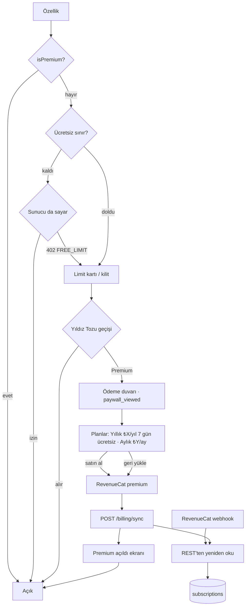

# Premium akışı: kontrol noktaları, kancalar ve abonelik

Son güncelleme: 2026-11-19. Durum: **abonelik açık** (RevenueCat, entitlement `premium`). Planlar Aylık + Yıllık, yıllıkta 7 gün ücretsiz deneme. Beta (`PREMIUM_BETA`) mobilde kapalı; sunucuda build 9 testçilere ulaşınca kapanacak.

## 1. Premium kim, nerede karar veriliyor

| Katman | Kaynak |
| --- | --- |
| Kimlik | RevenueCat app user id = **subjectId** (cihaz token'ının `sub`'ı; anonim kurulum ya da girilen hesap). Rastgele UUID. `deviceAuth.ts` `subjectOf/onIdentityChange` |
| Mobil | `services/purchases.ts`: `isPremium = PREMIUM_BETA \|\| RevenueCat "premium" \|\| sunucu`. Kimlik değişince `logIn(sub)` → `syncPurchases()` → `POST /billing/sync` |
| Sunucu | `subscriptions` tablosu (subject başına). `POST /billing/sync` ve `POST /webhooks/revenuecat` RevenueCat REST v1'den yeniden okur (gövdeye güvenilmez) |
| Karar | `DeviceEntitlementService.isPremium/premiumState`: beta ya da aktif abonelik (`expiresAt` geçince kendiliğinden düşer). Premium her özelliği açar |
| Beta | Mobil: eas.json'da üç profilde `EXPO_PUBLIC_PREMIUM_BETA=false`. Sunucu: Railway `PREMIUM_BETA` (build 9 sonrası `false`) |

## 2. Kapı noktaları

| Özellik | Ücretsiz sınır | İstemci | Sunucu |
| --- | --- | --- | --- |
| Aster sohbeti | 5/gün + geçiş | `CompanionScreen.tsx` | **Evet**: `FreeTierService.chargeCompanionMessage` → 402 `FREE_LIMIT` |
| Tarot | 1 okuma/gün + geçiş | `TarotScreen.tsx` | **Evet**: okuma anahtarı başına 1 (kart + sentez çağrıları tek okuma), 402 `FREE_LIMIT` |
| Uyum yorumu | 2 açı + kilit | `CompatibilityResultScreen.tsx` | **Evet**: premium ⇒ açık |
| Haftalık/aylık tahmin | kilitli | `ForecastScreen.tsx` | Hayır |
| En iyi günler araması | kilitli | `ElectionFormScreen.tsx` | Hayır |
| Manifest | 1 aktif | `ManifestScreen.tsx` | Hayır |
| Kişi haritası | 2 kişi | `savedPerson.ts` | Hayır (üst sınır 50) |
| PDF rapor | Premium | `ReportsScreen.tsx` | Günlük 3 (premium bilmiyor) |

Günler kullanıcının yerel günü (`localToday()` / `x-tz`). Sınırlar `apps/api/src/modules/billing/free-tier.ts` ↔ `useAppStore.ts` FREE_* (birlikte değişir).

## 3. Kancalar

1. Sınıra çarpınca: limit kartı (`SpotlightCard`, "Premium'u aç" + Yıldız Tozu geçişi). Sunucu 402 dönerse de aynı kart/duvar açılır.
2. Kilitli içerik: `PremiumGate` / ödeme duvarı (tahmin, uyum, kişi, rapor, seçim).
3. Profil: Premium kartı; abonede "Premium aktif · yenilenir/biter" (dokununca `PremiumPerksSheet`: açılan özellikler, yenileme tarihi, adil kullanım, "Aboneliği yönet"), "Aboneliği yönet", değilse "Satın alımı geri yükle".

"Aboneliği yönet" (Profil satırı, `PremiumPerksSheet`, veri silme onayı) iOS'ta `openManageSubscriptions()` ile Apple'ın uygulama içi abonelik penceresini açar (`Purchases.showManageSubscriptions`; TestFlight/sandbox aboneliklerini de gösterir), kapanınca entitlement yeniden okunur; açılamazsa mağazanın web sayfası.

Ölçüm (PostHog): `paywall_viewed{source}`, `purchase_started/completed/failed`, `purchases_restored`.

## 4. Akış

## 5. Bilinen davranışlar

- Hesapla satın alıp ikinci telefonda giriş: aynı subject, abonelik doğrudan gelir.
- Anonimken satın alıp sonra hesaba giriş: `syncPurchases` makbuzu hesaba taşır (RevenueCat "Transfer to new App User ID").
- Çıkış: yeni anonim subject ücretsizdir; tekrar girişte geri gelir. Çıkıştan sonra "Geri yükle" aboneliği anonim kimliğe taşıyabilir (kabul edildi).
- Verilerimi sil: `subscriptions` satırı silinir, mağaza aboneliği **iptal olmaz** (onayda uyarı + "Aboneliği yönet").
- `environment` (SANDBOX/PRODUCTION) yalnızca kayıt; App Review sandbox'ta satın alır.

## 6. Yayın listesi

- [ ] App Store Connect: Paid Applications Agreement, banka, vergi
- [ ] Abonelik grubu + `…premium.monthly`, `…premium.yearly` (7 gün ücretsiz), inceleme görseli
- [ ] RevenueCat: proje, IAP key, ürünler → `premium`, `default` offering, webhook (`/api/v1/webhooks/revenuecat` + Authorization)
- [ ] EAS: `EXPO_PUBLIC_REVENUECAT_IOS_KEY` · Railway: `REVENUECAT_SECRET_KEY`, `REVENUECAT_WEBHOOK_AUTH`
- [ ] App Privacy: Purchase History → Linked: Yes, yeniden Publish
- [ ] Web: gizlilikte "anonim kimlik" cümlesi → "uygulama kimliğine bağlı"; Koşullar'a abonelik maddesi; yeniden yayın
- [ ] Build 9 → sandbox testleri → Railway `PREMIUM_BETA=false` → abonelikleri 1.1.0'a ekle, gönder
